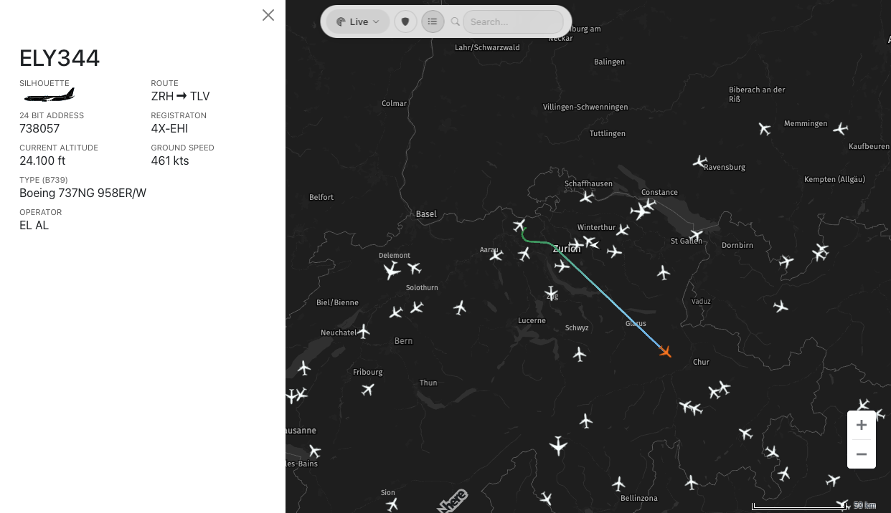

# Flightradar

A self-hosted flight tracker for your own ADS-B receiver. Flightradar takes the raw signals your antenna picks up, works out which aircraft they belong to, and shows them live on a map in your browser, much like the big commercial flight tracking sites but running on your own data and hardware.



## What it does

**Live map**
- Shows every aircraft your receiver can hear on a dark map, with icons that match the aircraft type (airliner, business jet, helicopter, balloon and so on) and point in the direction of travel.
- Updates continuously over a live stream, with smooth movement between position reports instead of jumpy markers.
- Click an aircraft to see its track drawn behind it, colored by altitude from red near the ground through green and blue up to violet at cruising level.

**Flight details**
- Callsign, route (e.g. `ZRH → TLV`), registration, 24-bit ICAO address, aircraft type and operator, plus current altitude and ground speed.
- A silhouette of the aircraft type and the airline's logo where one is available.

**Search and filters**
- Search for live flights by callsign or airline.
- A toggleable list of all aircraft currently in view.
- A military filter that highlights military aircraft or shows only them.

**History**
- A flight log of past flights with a small map of each track, which you can open to replay the full route.
- An airlines view that groups recorded flights by operator.
- Old data is cleaned up automatically after a retention period you choose.

**Aircraft data enrichment**
- When an aircraft isn't in the local database, a background crawler looks up its registration, type and operator in several public sources and stores the result, so the details fill in by themselves over time.

**Admin dashboard**
- Shows statistics and the crawler's activity, lets you turn individual lookup sources on or off, and lets you correct aircraft records by hand.

**Data sources and deployment**
- Works with dump1090, Virtual Radar Server or a gRPC ADS-B feed.
- Ships as a single Docker image (Vue frontend and FastAPI backend, with MongoDB for storage), works on desktop and mobile, and has a documented REST API.

## Structure

- `backend/` - Python FastAPI application
- `frontend/` - Vue.js TypeScript application
- `contrib/` - Configuration files for deployment

## Deployment (Production)

The application is containerized as a single Docker image that serves both the frontend and backend.

### Using Docker Compose (Recommended)

```bash
# Create .env file from example (first time only)
cp .env.example .env
# Edit .env and add your configuration

# Build and start the application
docker-compose up -d

# View logs
docker-compose logs -f

# Stop the application
docker-compose down
```

**Note:** Docker Compose reads environment variables from `.env` file in the project root (same directory as `docker-compose.yml`). Copy your `backend/.env` to the root or create a new one based on `.env.example`.

The application will be available at:
- Frontend: [http://localhost:8080](http://localhost:8080)
- Backend API: [http://localhost:8083/api/v1/docs](http://localhost:8083/api/v1/docs)

### Using Docker directly

```bash
# Build the image
docker build -t flightradar .

# Run the container
docker run -p 80:80 \
  -e VITE_FLIGHT_API_URL=/api \
  -e VITE_HERE_API_KEY=your_key_here \
  flightradar
```

### Environment Variables

Configure the application using environment variables:

**Frontend:**
- `VITE_FLIGHT_API_URL` - Full API URL with protocol, host, and path (e.g., `http://localhost:8000/api/v1` for local, or `https://your-domain.com/api/v1` for production)
- `VITE_HERE_API_KEY` - HERE Maps API key
- `VITE_CLIENT_SECRET` - Shared secret for authentication (must match backend `CLIENT_SECRET`)
- `VITE_MOCK_DATA` - Use mock data (default: `false`)
- `VITE_ENABLE_INTERPOLATION` - Enable aircraft position interpolation (default: `true`)

**Backend:**
- `MONGODB_URI` - MongoDB connection string
- `MONGODB_DB_NAME` - Database name
- `JWT_SECRET` - Secret for signing JWT tokens (generate with `openssl rand -hex 32`)
- `CLIENT_SECRET` or `VITE_CLIENT_SECRET` - Shared secret for anonymous auth. Backend accepts either, so you can set just `VITE_CLIENT_SECRET` for both.
- `ALLOWED_ORIGINS` - Comma-separated frontend origins (e.g., `https://flightradar.example.com`). Required for cross-origin requests with cookies. Defaults to localhost for development.

> **Note on ALLOWED_ORIGINS:** When the frontend and backend are on different domains (or ports), browsers enforce Cross-Origin Resource Sharing (CORS) restrictions. Since authentication uses HTTP-only cookies, the backend must explicitly allow the frontend's origin. Wildcards (`*`) cannot be used with cookie-based auth.

## Development

For development, run the frontend and backend separately using their respective dev servers:

### Backend Development
```bash
cd backend
uv sync
uv run uvicorn flightradar:app --reload --port 8083
```

### Frontend Development
```bash
cd frontend
npm install
npm run dev
```

The frontend dev server (Vite) will run on port 5173 and can proxy API requests to the backend on port 8083.

## Architecture

**Production Setup:**
- Nginx serves static frontend files on port 80
- Backend FastAPI runs via uvicorn on port 8083 (exposed)
- Both services run in a single container managed by supervisord
- Frontend is built during the Docker image build process with the API URL baked in
- Frontend accesses backend directly via FQDN (e.g., `http://localhost:8083/api/v1` or `https://api.your-domain.com/api/v1`)

**Development Setup:**
- Frontend: Vite dev server with hot reload
- Backend: uvicorn with --reload flag
- Separate processes for better development experience
